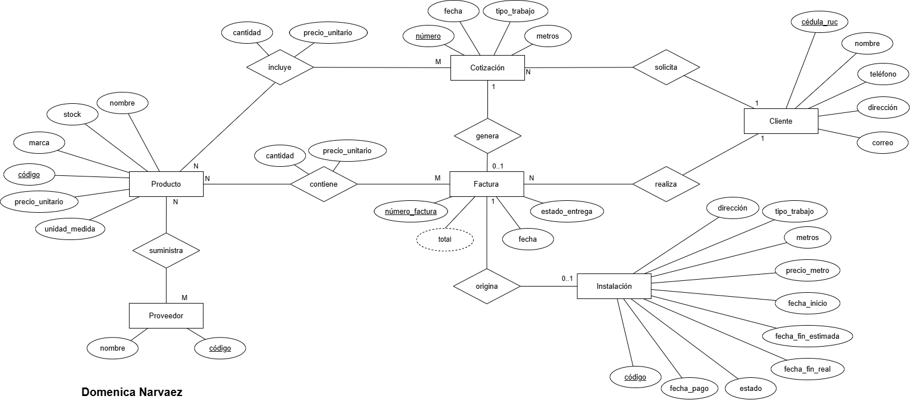

# Modelo Entidad-Relación

[⬅ Volver al inicio](../README.md)

*Figura 1. Diagrama Entidad-Relación del sistema Megatumbados.*

## Entidades

| Entidad | Atributos | Clave |
|---|---|---|
| Producto | código, nombre, marca, precio_unitario, unidad_medida, stock | código |
| Proveedor | código, nombre | código |
| Cliente | cédula_ruc, nombre, teléfono, dirección, correo | cédula_ruc |
| Cotización | número, fecha, tipo_trabajo, metros | número |
| Factura | número_factura, fecha, total (derivado), estado_entrega | número_factura |
| Instalación | código, dirección, tipo_trabajo, metros, precio_metro, fecha_inicio, fecha_fin_estimada, fecha_fin_real, estado, fecha_pago | código |

## Relaciones

| Relación | Entidades | Cardinalidad | Atributos de la relación |
|---|---|---|---|
| suministra | Proveedor – Producto | M:N | — |
| solicita | Cliente – Cotización | 1:N | — |
| incluye | Cotización – Producto | M:N | cantidad, precio_unitario |
| realiza | Cliente – Factura | 1:N | — |
| contiene | Factura – Producto | M:N | cantidad, precio_unitario |
| genera | Cotización – Factura | 1:0..1 | — |
| origina | Factura – Instalación | 1:0..1 | — |

La cantidad y el precio unitario se guardan en las relaciones *incluye* y *contiene* porque registran el precio vigente al momento de cotizar o vender, que puede ser distinto del precio actual del producto.

---

[Siguiente: Modelo Relacional ➡](../2_Relacional/README.md)
