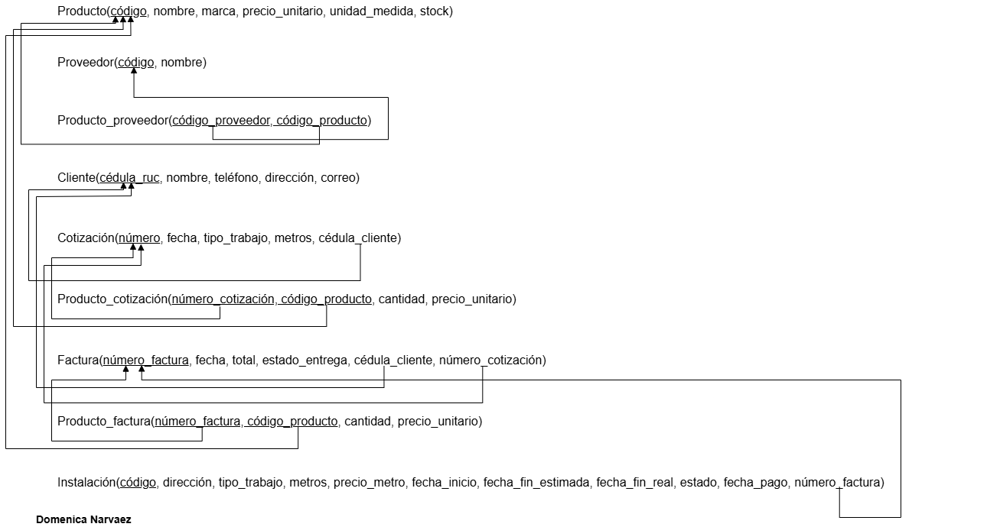

# Modelo Relacional

[⬅ Volver al inicio](../README.md)

*Figura 2. Diagrama relacional del sistema Megatumbados.*

## Esquema

PK = clave primaria · FK = clave foránea

| Tabla | Atributos y tipo de dato | PK | FK |
|---|---|---|---|
| Producto | codigo VARCHAR(10), nombre VARCHAR(80), marca VARCHAR(70), precio_unitario DECIMAL(10,2), unidad_medida VARCHAR(20), stock INT | codigo | — |
| Proveedor | codigo VARCHAR(10), nombre VARCHAR(80) | codigo | — |
| Producto_proveedor | codigo_proveedor VARCHAR(10), codigo_producto VARCHAR(10) | (codigo_proveedor, codigo_producto) | codigo_proveedor → Proveedor(codigo) codigo_producto → Producto(codigo) |
| Cliente | cedula_ruc VARCHAR(13), nombre VARCHAR(80), telefono VARCHAR(15), direccion VARCHAR(90), correo VARCHAR(50) | cedula_ruc | — |
| Cotizacion | numero INT, fecha DATE, tipo_trabajo ENUM, metros DECIMAL(8,2), cedula_cliente VARCHAR(13) | numero | cedula_cliente → Cliente(cedula_ruc) |
| Producto_cotizacion | numero_cotizacion INT, codigo_producto VARCHAR(10), cantidad INT, precio_unitario DECIMAL(10,2) | (numero_cotizacion, codigo_producto) | numero_cotizacion → Cotizacion(numero) codigo_producto → Producto(codigo) |
| Factura | numero_factura INT, fecha DATE, total DECIMAL(10,2), estado_entrega ENUM, cedula_cliente VARCHAR(13), numero_cotizacion INT | numero_factura | cedula_cliente → Cliente(cedula_ruc) numero_cotizacion → Cotizacion(numero) |
| Producto_factura | numero_factura INT, codigo_producto VARCHAR(10), cantidad INT, precio_unitario DECIMAL(10,2) | (numero_factura, codigo_producto) | numero_factura → Factura(numero_factura) codigo_producto → Producto(codigo) |
| Instalacion | codigo INT, direccion VARCHAR(90), tipo_trabajo ENUM, metros DECIMAL(8,2), precio_metro DECIMAL(8,2), fecha_inicio DATE, fecha_fin_estimada DATE, fecha_fin_real DATE, estado ENUM, fecha_pago DATE, numero_factura INT | codigo | numero_factura → Factura(numero_factura) |

## Reglas de transformación aplicadas

- Cada entidad se convirtió en una tabla con su clave primaria.
- Las relaciones 1:N (*solicita*, *realiza*) pasaron como clave foránea en el lado de muchos.
- Las relaciones M:N (*suministra*, *incluye*, *contiene*) se convirtieron en tablas intermedias con clave primaria compuesta por las claves de ambas entidades.
- Las relaciones 1:0..1 (*genera*, *origina*) pasaron como clave foránea con restricción UNIQUE, para que una cotización genere como máximo una factura y una factura origine como máximo una instalación.

---

[⬅ Anterior: Modelo Entidad-Relación](../1_Entidad_Relacion/README.md) · [Siguiente: Código SQL ➡](../3_SQL/README.md)
