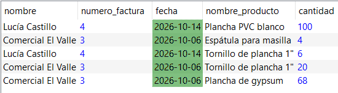
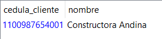
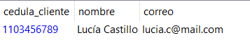
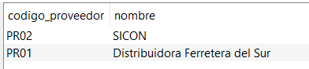
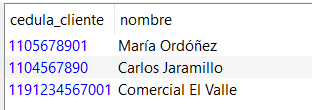

# Consultas en álgebra relacional y SQL

[⬅ Volver al inicio](../README.md)

Cinco consultas formuladas primero en álgebra relacional y luego traducidas a SQL. Cada una combina dos o más tablas y usa un operador distinto. Las expresiones de álgebra están escritas con la notación de la herramienta **Relational**, donde se ejecutaron sobre los [archivos CSV](../4_Pruebas_Datos_Simulados/csv).

| Consulta | Operador principal |
|---|---|
| Consulta 1 | Reunión (⋈), selección (σ) y proyección (π) |
| Consulta 2 | Diferencia (−) |
| Consulta 3 | Intersección (∩) |
| Consulta 4 | División (÷) y renombre (ρ) |
| Consulta 5 | Unión (∪) |

Archivo con las 5 consultas en SQL: [consultas.sql](consultas.sql)

## Consulta 1 — Reunión (⋈), selección (σ) y proyección (π)

**Descripción:** Mostrar el nombre del cliente, el número y la fecha de la factura y el nombre y la cantidad de cada producto comprado, solo de las facturas con entrega PENDIENTE emitidas en octubre de 2026.

**Álgebra relacional:**

```
π nombre, numero_factura, fecha, nombre_producto, cantidad (σ estado_entrega == 'PENDIENTE' and fecha.year == 2026 and fecha.month == 10 (ρ cedula_ruc ➡ cedula_cliente (cliente) ⋈ factura ⋈ producto_factura ⋈  ρ codigo ➡ codigo_producto, nombre ➡ nombre_producto (π codigo, nombre (producto))))
```

**SQL:**

```sql
SELECT c.nombre,
       f.numero_factura,
       f.fecha,
       p.nombre AS nombre_producto,
       pf.cantidad
FROM Cliente c
JOIN Factura f            ON c.cedula_ruc = f.cedula_cliente
JOIN Producto_factura pf  ON f.numero_factura = pf.numero_factura
JOIN Producto p           ON pf.codigo_producto = p.codigo
WHERE f.estado_entrega = 'PENDIENTE'
  AND YEAR(f.fecha) = 2026
  AND MONTH(f.fecha) = 10;
```

**Resultado esperado:** Se obtiene una nueva relación de 5 tuplas que contiene el nombre del cliente, el número y la fecha de la factura, y el nombre y la cantidad de cada producto de las facturas pendientes de entrega emitidas en octubre de 2026. Se observa que dos clientes, Comercial El Valle (factura 3) y Lucía Castillo (factura 4), tienen materiales aún por entregar.



*Figura 3. Resultado de la Consulta 1 en Relational.*

## Consulta 2 — Diferencia (−)

**Descripción:** Obtener la cédula y el nombre de los clientes que solicitaron al menos una cotización pero nunca realizaron una compra, es decir, que no tienen ninguna factura.

**Álgebra relacional:**

```
π cedula_cliente, nombre(ρ cedula_ruc ➡ cedula_cliente (cliente) ⋈ (π cedula_cliente (cotizacion)  -  π cedula_cliente (factura)))
```

**SQL:**

```sql
SELECT c.cedula_ruc, c.nombre
FROM Cliente c
WHERE c.cedula_ruc IN (SELECT cedula_cliente FROM Cotizacion)
  AND c.cedula_ruc NOT IN (SELECT cedula_cliente FROM Factura);
```

**Resultado esperado:** Se obtiene una relación con la cédula/RUC y el nombre de los clientes que solicitaron al menos una cotización pero no realizaron ninguna compra. En este caso, Constructora Andina pidió una cotización pero no la concretó, lo que sirve para hacer seguimiento a clientes potenciales.



*Figura 4. Resultado de la Consulta 2 en Relational.*

## Consulta 3 — Intersección (∩)

**Descripción:** Obtener el nombre, la cédula o RUC y el correo de los clientes que pidieron una cotización de PVC y que además tienen una factura PENDIENTE de entrega.

**Álgebra relacional:**

```
π cedula_cliente, nombre, correo (ρ cedula_ruc➡cedula_cliente (cliente) ⋈ (π cedula_cliente (σ tipo_trabajo == 'PVC' (cotizacion)) ∩ π cedula_cliente (σ estado_entrega == 'PENDIENTE' (factura))))
```

**SQL:**

```sql
SELECT cedula_ruc, nombre, correo
FROM Cliente
WHERE cedula_ruc IN (SELECT cedula_cliente FROM Cotizacion
                     WHERE tipo_trabajo = 'PVC')
  AND cedula_ruc IN (SELECT cedula_cliente FROM Factura
                     WHERE estado_entrega = 'PENDIENTE');
```

**Resultado esperado:** Se obtiene una relación con la cédula, el nombre y correo de los clientes que pidieron una cotización de PVC y que además tienen una factura PENDIENTE de entrega. En este caso, Lucía Castillo pidió una cotización para PVC y le hace falta la entrega de una compra que realizó.



*Figura 5. Resultado de la Consulta 3 en Relational.*

## Consulta 4 — División (÷) y renombre (ρ)

**Descripción:** Encontrar el código y el nombre de los proveedores que suministran todos los productos de la marca Stanley.

**Álgebra relacional:**

```
ρ codigo ➡ codigo_proveedor  (proveedor) ⋈ (producto_proveedor ÷ ρ codigo ➡ codigo_producto (π codigo(σ marca == 'Stanley' (producto))))
```

**SQL:**

```sql
SELECT pr.codigo, pr.nombre
FROM Proveedor pr
JOIN Producto_proveedor pp ON pr.codigo = pp.codigo_proveedor
JOIN Producto p ON pp.codigo_producto = p.codigo
WHERE p.marca = 'Stanley'
GROUP BY pr.codigo, pr.nombre
HAVING COUNT(*) = (SELECT COUNT(*) FROM Producto
                   WHERE marca = 'Stanley');
```

**Resultado esperado:** Se obtiene una relación con el código y el nombre de los proveedores que suministran todos los productos de la marca Stanley. Se identifica que SICON (PR02) y la Distribuidora Ferretera del Sur (PR01) suministran todos los productos Stanley (P003 y P004) a Megatumbados.



*Figura 6. Resultado de la Consulta 4 en Relational.*

## Consulta 5 — Unión (∪)

**Descripción:** Obtener la cédula y el nombre de los clientes que han solicitado una cotización de gypsum o que han tenido una instalación de gypsum.

**Álgebra relacional:**

```
π cedula_cliente, nombre (ρ cedula_ruc➡cedula_cliente (cliente) ⋈ (π cedula_cliente (σ tipo_trabajo == 'GYPSUM' (cotizacion)) ∪ π cedula_cliente (σ tipo_trabajo == 'GYPSUM' (instalacion) ⋈ factura)))
```

**SQL:**

```sql
SELECT cedula_ruc, nombre
FROM Cliente
WHERE cedula_ruc IN (SELECT cedula_cliente FROM Cotizacion
                     WHERE tipo_trabajo = 'GYPSUM')
   OR cedula_ruc IN (SELECT f.cedula_cliente
                     FROM Instalacion i
                     JOIN Factura f ON i.numero_factura = f.numero_factura
                     WHERE i.tipo_trabajo = 'GYPSUM');
```

**Resultado esperado:** Se obtiene una nueva relación de 3 tuplas con la cédula/RUC y el nombre de los clientes que han trabajado con gypsum, ya sea porque solicitaron una cotización de este tipo o porque tuvieron una instalación de gypsum. Los clientes que cumplen ambas condiciones aparecen una sola vez, ya que la unión elimina los repetidos. En este caso, Carlos Jaramillo y Comercial El Valle cumplen ambas condiciones, mientras que María Ordóñez aparece solo porque tuvo una instalación de gypsum sin haber solicitado cotización.



*Figura 7. Resultado de la Consulta 5 en Relational.*

---

[⬅ Anterior: Pruebas con datos simulados](../4_Pruebas_Datos_Simulados/README.md) · [Siguiente: Anexos ➡](../6_Anexos/README.md)
