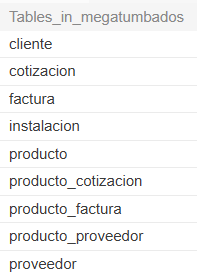
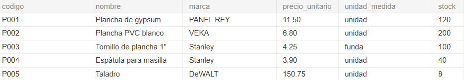
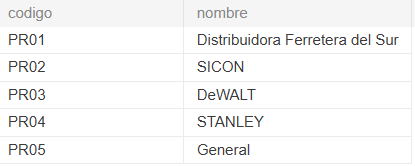
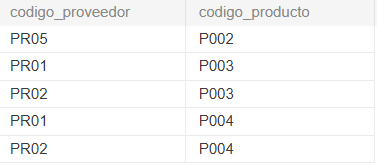
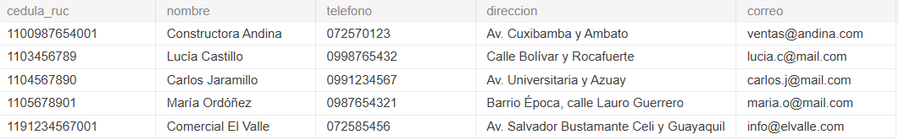
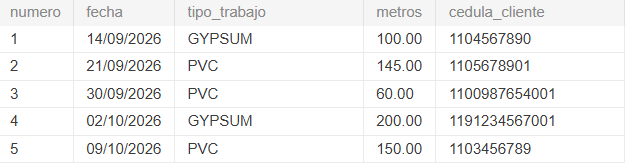
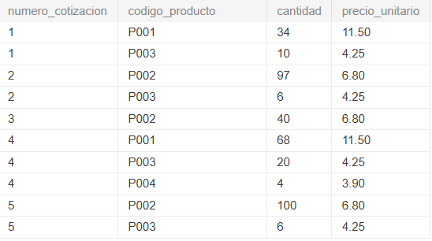
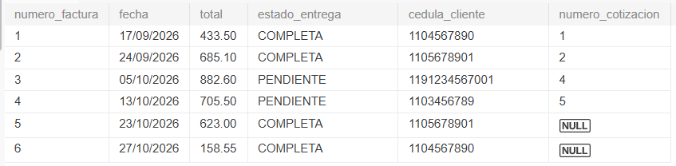
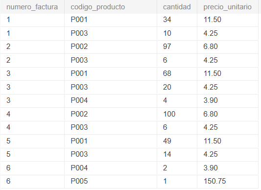
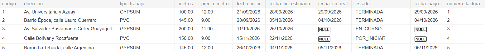

# Anexos

[⬅ Volver al inicio](../README.md)

## Anexo A. Evidencia de la creación de las tablas en MySQL

*Figura 8. Tablas creadas en la base de datos megatumbados en MySQL.*

## Anexo B. Evidencia de la inserción de los datos simulados

*Figura 9. Registros insertados en la tabla Producto.*

*Figura 10. Registros insertados en la tabla Proveedor.*

*Figura 11. Registros insertados en la tabla Producto_proveedor.*

*Figura 12. Registros insertados en la tabla Cliente.*

*Figura 13. Registros insertados en la tabla Cotizacion.*

*Figura 14. Registros insertados en la tabla Producto_cotizacion.*

*Figura 15. Registros insertados en la tabla Factura.*

*Figura 16. Registros insertados en la tabla Producto_factura.*

*Figura 17. Registros insertados en la tabla Instalacion.*

---

[⬅ Anterior: Consultas](../5_Algebra_Relacional/README.md) · [Volver al inicio](../README.md)
